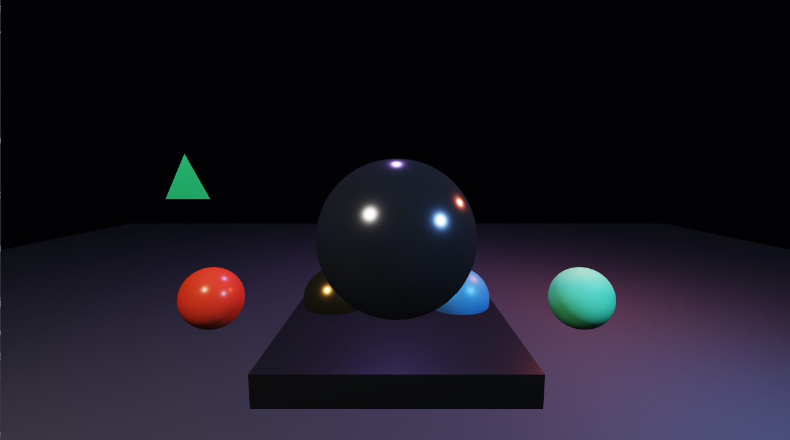

# Hyperion Game Engine

Hyperion is a from-scratch 3D game engine written in C# on .NET 10. It owns its
scene model, render loop, camera, meshes, materials, and shaders while using
[OpenTK](https://opentk.net/) as a thin cross-platform layer for windowing,
input, and OpenGL access.

The project is currently at **First Light**: a small but working real-time 3D
foundation with a fly camera, lit geometry, material properties, and a sandbox
scene. The long-term goal is a modern high-fidelity renderer built one clear,
testable layer at a time.

> Hyperion is an educational, early-stage engine—not a production replacement
> for Unity, Unreal Engine, or Godot yet.

## Current features

- OpenGL 3.3 core renderer
- Stable update and render loop
- Entity, world, and transform model
- Free-fly perspective camera
- Keyboard and mouse input
- Cube, plane, and generated UV-sphere primitive meshes
- Depth testing and back-face culling
- 4x multisample anti-aliasing
- Configurable real-time point lights
- Cook–Torrance metallic/roughness PBR shading
- Metallic and roughness material inputs
- ACES-style tone mapping and gamma correction
- Separate reusable engine and sandbox projects
- Cached `.gltf`/`.glb` geometry and PBR-factor import
- Automatic mesh bounds, spatial partitioning, and camera culling
- Central package versions, strict analyzers, and repository-wide code style

## Screenshot



The current PBR laboratory renders a polished hero sphere, four material
samples, an animated light rig, a glTF pipeline fixture, and a graphite stage.

## Requirements

- Windows, Linux, or macOS
- [.NET 10 SDK](https://dotnet.microsoft.com/download/dotnet/10.0)
- A GPU and driver supporting OpenGL 3.3 or newer

## Quick start

Clone and run the sandbox:

```powershell
git clone https://github.com/dharunnarayanvenkatesh/hyperion-game-engine.git
cd hyperion-game-engine
dotnet restore
dotnet run --project src/Hyperion.Sandbox
```

Build the complete solution:

```powershell
dotnet build Hyperion.slnx
```

## Controls

| Input | Action |
| --- | --- |
| `W`, `A`, `S`, `D` | Move forward, left, backward, and right |
| Hold right mouse button + move | Look around |
| `Space` | Move up |
| `Left Shift` | Move down |
| `Escape` | Close the sandbox |

## Project structure

```text
Hyperion.slnx
src/
  Hyperion.Engine/
    Core/       Application loop and timing
    Graphics/   Camera, shaders, GPU meshes, materials, and renderer
    Scene/      World, entities, and transforms
  Hyperion.Sandbox/
    Program.cs  Demo scene and engine integration example
assets/         Runtime assets and importer fixtures
docs/           Architecture and Blender pipeline guides
```

The engine is a class library. `Hyperion.Sandbox` is a small executable that
references it and acts as the development playground for new engine features.

See [Blender to Hyperion](docs/BLENDER_GLTF_PIPELINE.md) for export and runtime
loading instructions, and [Architecture](docs/ARCHITECTURE.md) for ownership
and scalability decisions.

## Rendering roadmap

- [x] Window, OpenGL context, and frame loop
- [x] Transformable scene entities
- [x] Lit primitive geometry
- [x] Cook–Torrance metallic/roughness shading
- [x] Camera and input system
- [x] glTF 2.0 geometry and material-factor import
- [ ] glTF textures, hierarchy, and animation
- [ ] Texture-backed PBR materials
- [ ] HDR sky and image-based lighting
- [ ] Directional and local-light shadows
- [ ] Render graph and HDR framebuffers
- [ ] Bloom, SSAO, TAA, and color grading
- [ ] Skeletal animation and particles
- [ ] Physics, audio, and an editor

## Design principles

- **Own the architecture.** Platform libraries provide bindings; Hyperion owns
  the engine abstractions and rendering decisions.
- **Build vertical slices.** Every milestone should end in a visible, runnable
  result.
- **Keep the runtime inspectable.** Prefer straightforward systems and explicit
  data flow over premature abstraction.
- **Earn visual complexity.** High-fidelity features arrive on top of verified
  fundamentals rather than hiding an unstable foundation.

## Development status

Hyperion is under active development. APIs and file formats may change rapidly
while the renderer and scene architecture are established.

Contributions, experiments, and constructive feedback are welcome. Please open
an issue before starting a large change so the design can be discussed first.

## License

No license has been selected yet. Until one is added, copyright remains with
the project owner and reuse is not automatically granted.
